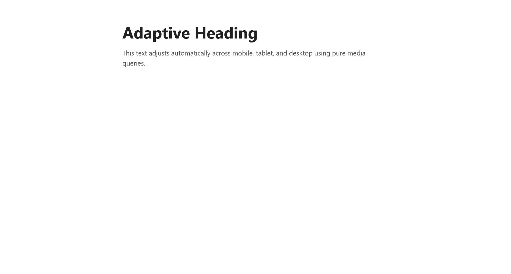
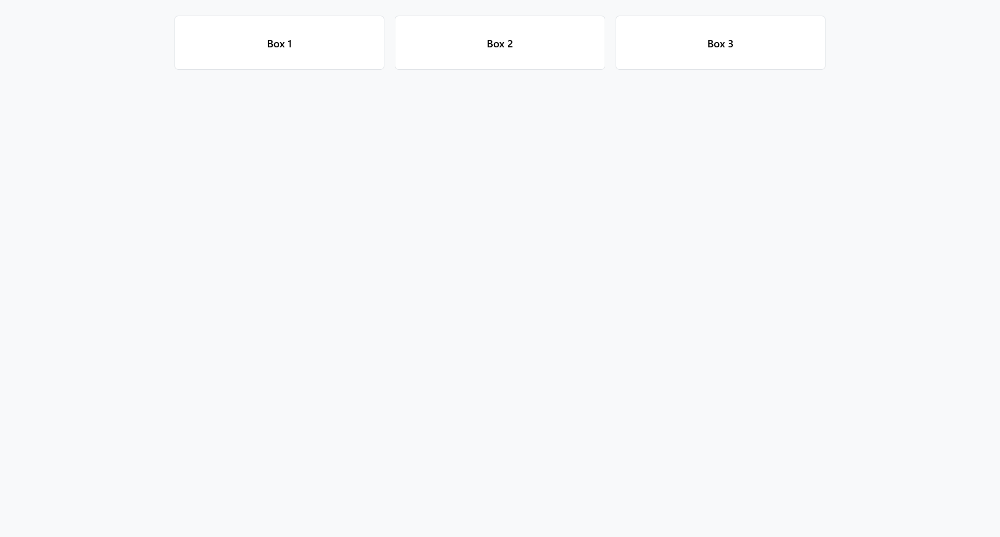
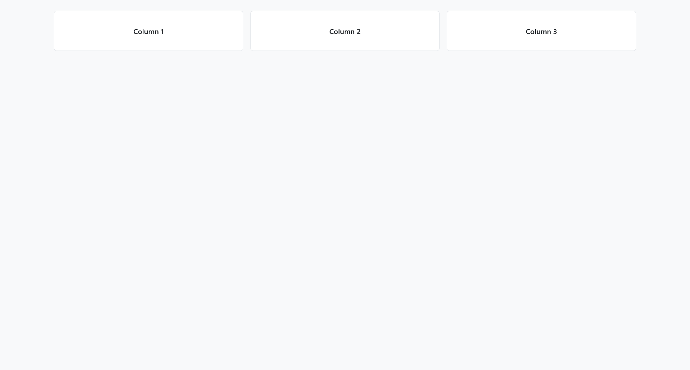
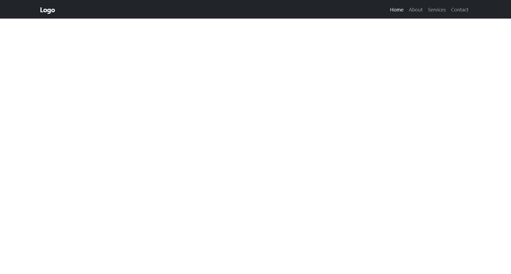
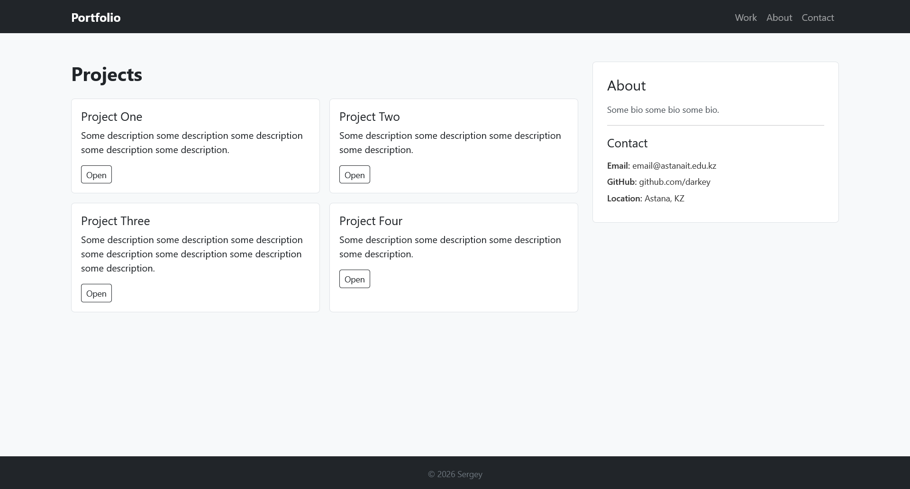

# Bootstrap Responsive Grid Lab (assignment 3)

- **Name:** Sergey
- **Group:** SE-2540
- **Live site:** https://dar-key.github.io/bootstrap-responsive-grid-lab
- **Repository:** https://github.com/dar-key/bootstrap-responsive-grid-lab

---

## Task 0

Created a simple header with navigation links using flexbox.

## Task 1

Created a simple text that adjusts its size automatically to different viewports using media queries.

## Task 2

Created 3 boxes that adjust their size and flexbox layout automatically to different viewports using media queries

## Task 3

Created a navigation bar that has responsive collapse button that appears on certain viewports.

## Task 4

Created a simple portfolio website using Bootstrap and semantic HTML tags. It has a navigation bar and responsive collapse button that appears on mobile viewports.

---

## Summary

This project implements responsive web design using pure CSS media queries alongside Bootstrap 12-column grid system. All tasks, culminating in an adaptive portfolio page, were built to adjust seamlessly across mobile, tablet, and desktop viewports.
